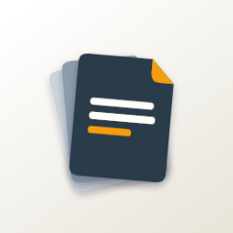
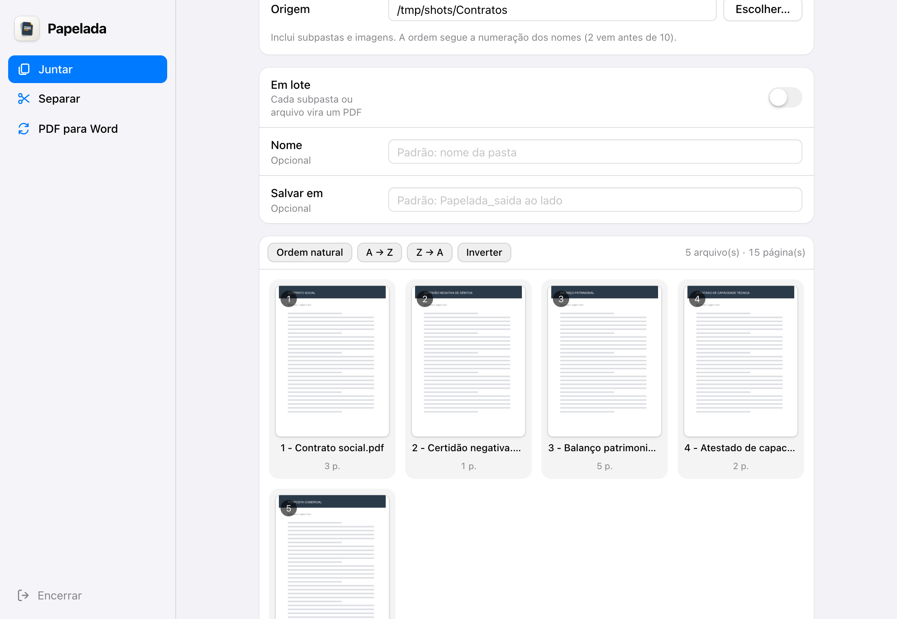
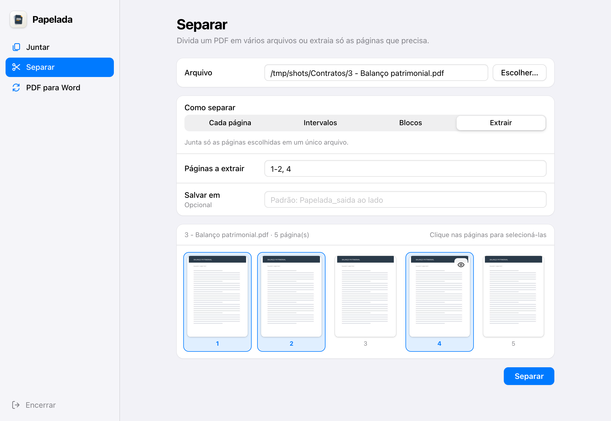
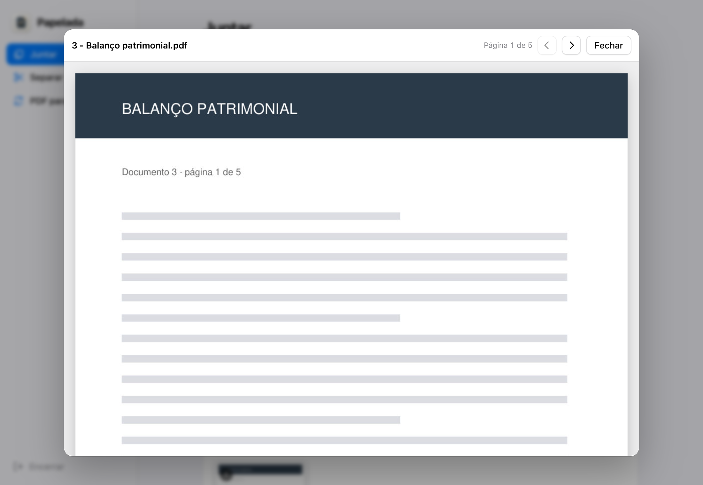
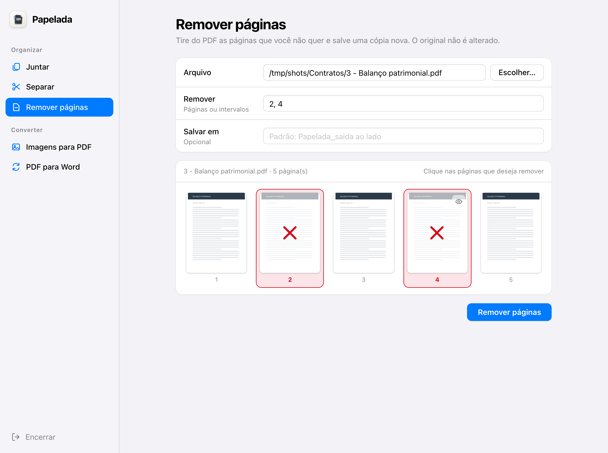
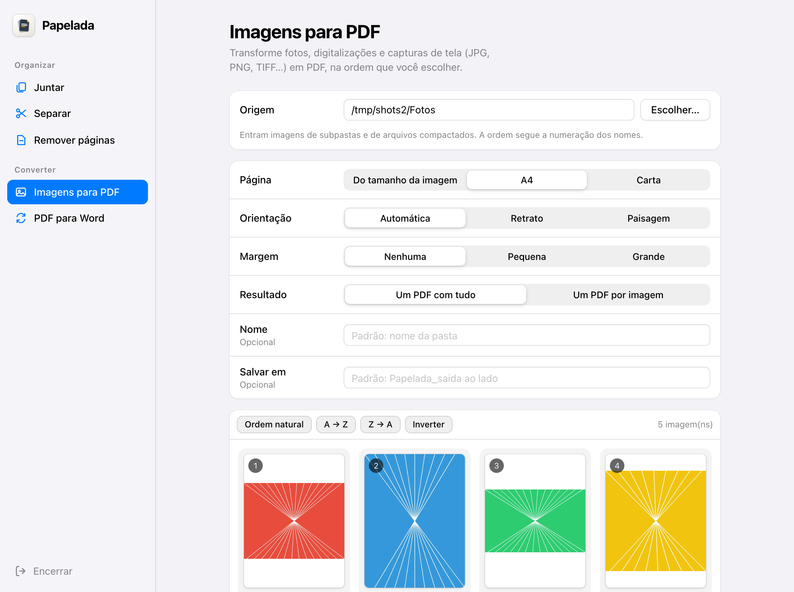
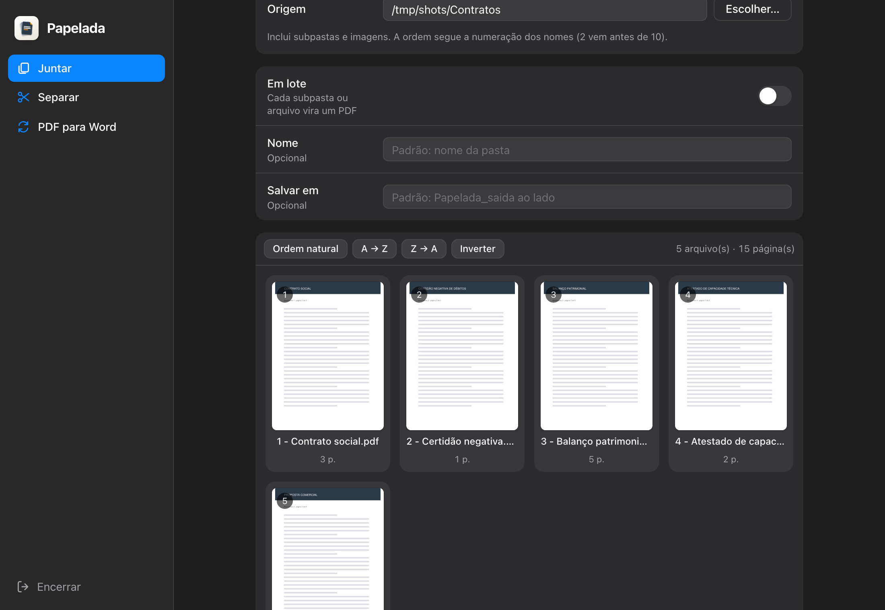

<p align="center"></p>

<h1 align="center">Papelada</h1>

<p align="center"><b>Junte, separe e converta PDFs em massa. Grátis, open source e 100% no seu computador.</b></p>

<p align="center">
  <a href="https://github.com/Adryanrr/papelada/actions/workflows/ci.yml"></a>
  <a href="LICENSE"></a>
  
  
</p>

<p align="center"></p>

> **English:** Papelada is a free, open-source desktop app (macOS, Windows, Linux) to merge, split and convert PDFs in bulk. It unpacks `.zip`/`.rar`/`.7z`, shows page thumbnails, lets you reorder files visually and converts PDF to Word. Everything runs locally: no uploads, no limits, no ads. The UI is in Brazilian Portuguese.

## Por que o Papelada?

Quem lida com muita documentação (licitações, prestação de contas, contratos, processos) acaba juntando dezenas de arquivos, em pastas e `.zip` diferentes, na ordem certa. Os sites de PDF fazem isso bem, mas limitam o tamanho e a quantidade de arquivos no plano grátis, mostram anúncios e exigem enviar seus documentos para a internet.

O Papelada roda no seu computador, sem limites, e foi pensado para **muitos arquivos de uma vez**.

## O que ele faz hoje

| | |
| --- | --- |
| **Juntar** | Uma pasta, um `.zip`, `.rar`, `.7z` ou `.tar.gz` vira um único PDF. Entram subpastas, arquivos compactados dentro de outros e imagens (JPG, PNG…). A ordem segue a numeração dos nomes (`2 - …` antes de `10 - …`). |
| **Em lote** | Cada subpasta (ou arquivo compactado solto) vira um PDF, tudo de uma vez. |
| **Revisar e ordenar** | Miniaturas de cada arquivo, número de páginas, arrastar para reordenar, tirar arquivos da junção, ordenar A→Z / Z→A e abrir qualquer PDF no visualizador. |
| **Separar** | Uma página por arquivo, por intervalos (`1-3, 5, 8-10`), em blocos de N páginas ou extraindo só as páginas escolhidas. Você vê as páginas em miniatura e seleciona clicando. |
| **Remover páginas** | Escolha as páginas clicando nas miniaturas (ou digite `2, 5-7`) e salve uma cópia sem elas. O original não é alterado. |
| **Imagens para PDF** | Fotos, digitalizações e capturas de tela (JPG, PNG, TIFF, WebP…) de uma pasta, `.zip` ou arquivo viram PDF, na ordem que você escolher. Página do tamanho da imagem, A4 ou Carta, orientação automática, margem e opção de um PDF por imagem. Corrige fotos giradas pelo celular (EXIF). |
| **PDF para Word** | Converte um PDF, ou todos os PDFs de uma pasta, em `.docx` editável. |
| **Visualizador** | Abre qualquer PDF em tela grande, página a página. |
| **Visual nativo** | Interface no padrão de design da Apple, com tema claro e escuro automáticos e atalhos de teclado (⌘/Ctrl+1 a 5, O e Enter). |

<p align="center">
  
  
</p>
<p align="center">
  
  
</p>
<p align="center"></p>

## Baixar

Na página de [Releases](https://github.com/Adryanrr/papelada/releases) baixe o arquivo do seu sistema. Não precisa instalar Python.

| Sistema | Arquivo | Como abrir |
| --- | --- | --- |
| Windows 10/11 | `Papelada-windows-x64.exe` | Duplo clique. Se aparecer o SmartScreen: *Mais informações → Executar assim mesmo*. |
| macOS (Apple Silicon, M1 ou superior) | `Papelada-macos-arm64.dmg` | Abra o `.dmg` e arraste o Papelada para *Applications*. Se o macOS bloquear: *Ajustes do Sistema → Privacidade e Segurança → Abrir mesmo assim*, ou `xattr -dr com.apple.quarantine /Applications/Papelada.app`. |
| Linux | `Papelada-linux-x64` | `chmod +x Papelada-linux-x64 && ./Papelada-linux-x64` (abre no navegador). |

Os aplicativos ainda não são assinados digitalmente, por isso o aviso do sistema na primeira abertura. No Windows e no macOS o Papelada abre em janela própria (no Windows usa o WebView2, já presente no Windows 10/11 atualizado). No Linux abre no navegador, em `http://127.0.0.1:8765`.

> Ainda não há release publicado. Enquanto isso, rode pelo código (veja [Desenvolvimento](#desenvolvimento)).

## Comparativo com o iLovePDF

O objetivo do projeto é cobrir o que o [iLovePDF](https://www.ilovepdf.com/pt) oferece nos planos **Grátis** e **Premium**, mas localmente e sem limites. A tabela mostra onde estamos.

Legenda: ✅ pronto · 🟡 parcial · ❌ ainda não.
Dados do iLovePDF conferidos na página pública de planos em 16/11/2026; eles podem mudar. O Papelada não tem relação com o iLovePDF, que é marca de seus donos.

### Ferramentas

| Categoria | Recurso | iLovePDF Grátis | iLovePDF Premium | Papelada |
| --- | --- | :---: | :---: | :---: |
| Organizar | Juntar PDF | até 25 arquivos, 100 MB | até 500 arquivos, 4 GB | ✅ sem limites |
| Organizar | Dividir PDF | 1 arquivo, 100 MB | 4 GB | ✅ |
| Organizar | Dividir de forma inteligente (IA) | — | até 200 páginas | ❌ |
| Organizar | Remover páginas | ✔ | ✔ | ✅ por miniatura ou intervalo |
| Organizar | Extrair páginas | ✔ | ✔ | ✅ |
| Organizar | Organizar páginas (reordenar, girar, apagar) | até 5 arquivos | até 20 | ❌ |
| Organizar | Digitalizar e transformar em PDF | só no app móvel | ✔ | ❌ |
| Otimizar | Comprimir PDF | 2 arquivos, 200 MB | 10 arquivos, 4 GB | ❌ |
| Otimizar | Reparar PDF | ✔ | ✔ | ❌ |
| Otimizar | OCR (reconhecimento de texto) | básico, 15 MB | avançado | ❌ |
| Converter para PDF | JPG / imagens para PDF | até 20 imagens | até 500 | ✅ sem limites, com tamanho, orientação e margem |
| Converter para PDF | Word para PDF | 15 MB | 4 GB | ❌ |
| Converter para PDF | PowerPoint para PDF | 15 MB | 4 GB | ❌ |
| Converter para PDF | Excel para PDF | 15 MB | 4 GB | ❌ |
| Converter para PDF | HTML / página web para PDF | ✔ | ✔ | ❌ |
| Converter de PDF | PDF para JPG | 2 arquivos, 25 MB | 10 arquivos | ❌ |
| Converter de PDF | **PDF para Word** | 1 arquivo, 15 MB | 10 arquivos, 4 GB | ✅ sem OCR |
| Converter de PDF | PDF para PowerPoint | 15 MB | 4 GB | ❌ |
| Converter de PDF | PDF para Excel | 15 MB | 4 GB | ❌ |
| Converter de PDF | PDF para Word/PowerPoint/Excel com OCR | — | ✔ | ❌ |
| Converter de PDF | PDF para PDF/A | — | ✔ | ❌ |
| Editar | Girar PDF | ✔ | ✔ | ❌ |
| Editar | Números de página | ✔ | ✔ | ❌ |
| Editar | Marca d'água | ✔ | ✔ | ❌ |
| Editar | Recortar PDF | ✔ | ✔ | ❌ |
| Editar | Editar PDF (texto, imagens, formas) | ✔ | ✔ | ❌ |
| Editar | Formulários PDF | ✔ | ✔ | ❌ |
| Segurança | Desbloquear PDF | ✔ | ✔ | ❌ (hoje PDFs com senha são pulados, com aviso) |
| Segurança | Proteger PDF com senha | ✔ | ✔ | ❌ |
| Segurança | Assinar PDF | ✔ | ✔ + assinatura avançada | ❌ |
| Segurança | Ocultar informações (redigir) | ✔ | ✔ + modo inteligente por IA | ❌ |
| Segurança | Comparar PDFs | ✔ | ✔ | ❌ |
| Inteligência | Resumir com IA | — | ✔ | ❌ |
| Inteligência | Traduzir PDF | — | ✔ | ❌ |
| Inteligência | PDF para Markdown | ✔ | ✔ | ❌ |
| Automação | Fluxos de trabalho (encadear ferramentas) | — | ✔ | ❌ |

**Placar das 35 ferramentas:** 6 prontas · 29 pendentes.

### Plataforma e planos

| Item | iLovePDF Grátis | iLovePDF Premium | Papelada |
| --- | :---: | :---: | :---: |
| Preço | grátis | pago (mensal ou anual) | ✅ grátis e open source |
| Limite de tamanho e de arquivos por tarefa | sim | maior (até 4 GB) | ✅ nenhum |
| Anúncios | sim | não | ✅ nenhum |
| Seus arquivos | enviados para o servidor | enviados (ou app desktop) | ✅ nunca saem do computador |
| Aplicativo desktop (offline) | — | Windows e Mac | ✅ Windows, macOS e Linux |
| Aplicativo móvel | — | iOS e Android | ❌ |
| Descompactar `.zip` / `.rar` / `.7z` e juntar o conteúdo | — | — | ✅ |
| Processar muitas pastas de uma vez (lote por subpasta) | — | — | ✅ |
| Miniaturas, visualizador e reordenar por arrastar | ✔ | ✔ | ✅ |
| Interface em português | ✔ | ✔ | ✅ |
| Equipes, SSO e API | — | equipes | ❌ (fora do escopo por enquanto) |

## Roadmap

A ordem abaixo prioriza o que é útil no dia a dia e viável sem serviços externos. Quer ajudar? Abra uma [issue](https://github.com/Adryanrr/papelada/issues) ou um pull request.

**Fase 1: edição e organização de páginas** (PyMuPDF / pypdf)
- [x] Remover páginas (com seleção por miniatura)
- [ ] Organizar páginas: reordenar, girar e apagar na grade
- [ ] Girar PDF
- [ ] Números de página
- [ ] Marca d'água (texto e imagem)
- [ ] Recortar PDF
- [ ] Proteger e desbloquear com senha (e pedir a senha ao juntar)
- [x] Imagens para PDF (tamanho de página, orientação, margem e ordem)
- [ ] PDF para JPG
- [ ] Comprimir PDF
- [ ] Reparar PDF
- [ ] PDF para Markdown

**Fase 2: conversão e OCR**
- [ ] OCR (Tesseract / OCRmyPDF), inclusive PDF para Word com OCR
- [ ] PDF para Excel e PDF para PowerPoint
- [ ] Word, Excel e PowerPoint para PDF (via LibreOffice, quando instalado)
- [ ] HTML / página web para PDF
- [ ] PDF para PDF/A
- [ ] Comparar PDFs
- [ ] Redigir (ocultar informações)
- [ ] Assinar PDF e preencher formulários

**Fase 3: automação e IA**
- [ ] Fluxos de trabalho: encadear ferramentas e salvar como receita
- [ ] Resumir e traduzir PDF (modelo local ou com a sua chave de API)
- [ ] Divisão inteligente por conteúdo
- [ ] Ordem personalizada por pasta no modo lote
- [ ] Versão para Mac Intel e assinatura/notarização dos aplicativos

## Privacidade e segurança

- Nada é enviado para a internet: o programa abre um servidor só em `127.0.0.1` e a interface fala com ele localmente.
- A interface recusa requisições de outros sites (verificação de `Host` e `Origin`) e só permite baixar ou mostrar arquivos gerados na sessão atual.
- Arquivos compactados são extraídos numa pasta temporária, com proteção contra caminhos maliciosos (`../`), e a pasta é apagada ao fechar.

## Limitações conhecidas

- **PDF para Word** funciona com PDFs que têm texto selecionável. PDFs escaneados (só imagem) precisam de OCR, que ainda está no roadmap. Tabelas e layouts complexos podem sair com diferenças.
- `.zip` e `.tar*` são abertos pelo próprio programa. `.rar` e `.7z` usam uma ferramenta do sistema: no macOS e no Windows 10/11 já vem pronta (`bsdtar`); no Linux instale `libarchive-tools` ou `unar` (ou 7-Zip). Arquivos compactados protegidos por senha não são suportados.
- PDFs protegidos por senha são pulados na junção, com aviso.

## Desenvolvimento

Requer Python 3.9 ou superior.

```bash
git clone https://github.com/Adryanrr/papelada.git
cd papelada
python -m venv .venv && source .venv/bin/activate   # no Windows: .venv\Scripts\activate
pip install -e ".[dev]"
python -m papelada          # abre a interface (use --browser para o navegador, --port 9000 para trocar a porta)
pytest                      # roda os testes
pyinstaller packaging/papelada.spec   # gera o executável do seu sistema em dist/
```

Estrutura:

```
papelada/            código do app (merge, split, convert, archive, preview, server, static/index.html)
tests/               testes (pytest)
packaging/           spec do PyInstaller e ícones
assets/              fontes do ícone e scripts que o geram (assets/icon-kit)
.github/workflows/   CI e release automático dos executáveis
```

Os executáveis oficiais são gerados pelo GitHub Actions quando uma tag `v*` é publicada (`.github/workflows/release.yml`).

## Contribuindo

Contribuições são bem-vindas: sugestões de ferramentas, correções, traduções e testes em outros sistemas (principalmente Windows e Linux). Veja o [roadmap](#roadmap) para ideias de onde começar. Rode `pytest` antes de abrir o pull request.

## Licença

[MIT](LICENSE)
